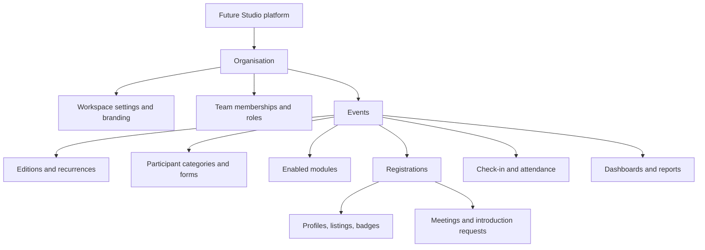

# 00 — Product scope

## What it is

A multi-tenant, white-label **Event Management SaaS**. An organisation registers, gets an
isolated workspace, brands it, then creates events. Each event enables only the modules
it needs. Registrations, participants, meetings, introductions, check-in and reports all
belong to that event, and events recur as **editions** so history accumulates instead of
resetting.

The commercial premise from the concept note: a recurring event (Innovation Village, every
year) should produce *one growing record* the organiser can decide from — not a fresh
spreadsheet each edition.

## Who it is for

- **Super Admin** — Future Studio. Platform operations, organisations, module
  availability, support views, platform statistics.
- **Organisation Admin** — owns one workspace: profile, branding, team, events, modules,
  reports.
- **Participant** — any person registered for an event. Public registration requires **no
  account** by default. Accounts exist only for ongoing participant features (profile
  editing, meetings, requests).

Operational responsibilities — Event Manager, Registration Manager, Check-in Staff,
Programme Manager, Reporting Officer — are **permissions inside an organisation**, not
global user types.

## Hierarchy

## Scope: P0 (required for the Innovation Village beta)

| Module | Core capability |
| --- | --- |
| Event management | Create, edit, duplicate, draft, publish, unpublish, complete, cancel, archive; dates, time zone, venue, visibility, registration window |
| Publishing & discovery | Branded public event page, shareable URL, listing, search and filters, public/unlisted/private visibility |
| Registration & badges | Event-specific categories, configurable forms, validation, consent, approval, duplicate detection, QR badge, email confirmation |
| Profiles & showcase | Participant / company / startup / innovation profiles, staff approval, visibility controls, search |
| Meetings & networking | Declared interests and availability, proposed meetings, accept/decline, staff confirmation, outcomes |
| Introduction queue | Interest requests with reason and offered help, staff assignment, decisions, status history, outcomes |
| Check-in | Mobile browser QR scanning, event validation, duplicate detection, attendance records, offline queue and sync |
| Dashboards & reports | Platform, organisation and event dashboards, live counts, aggregates, CSV/PDF exports, edition comparison |

## Scope: later

- **P1** — agenda and sessions, speakers, rooms, reminders, surveys, post-event follow-up.
- **P2** — sponsor portal, AI tagging/summaries/meeting briefs, secure data room,
  intentions board, wallet, video.

## Explicitly out of scope for the MVP

AI matching and generated reports, a public third-party module marketplace, full CRM,
payments/ticketing settlement, video-conferencing infrastructure, advanced data room,
advanced sponsor portal.

Exclusions must not block future extension: the module registry and adapter seams exist
so these can be added without restructuring.

## Product boundaries worth stating

- Participant categories describe a role **within one event**. They are not a global
  classification, and category in event A says nothing about event B.
- Cross-organisation identity matching is **not** assumed. Any reuse requires an explicit
  privacy decision (see `11-open-decisions.md`).
- Public-facing statistics are aggregated and anonymised. Personally identifiable data is
  visible only to authorised roles.
- Disabling a module never deletes its historical records.

## Sources

The plans were consolidated from four source documents kept in the repository root:

- `Event_Platform_Master_Project_Plan.docx` — product vision, architecture, functional
  scope and implementation roadmap
- `Future_Studio_Event_Platform_Full_PRD_and_Architecture.docx` — product requirements
  and technical specification
- `Innovation_Village_Concept.pdf` — the concept note for the first edition
- `Event_Platform_Backend_Development_Plan.docx` and
  `Event_Platform_Frontend_Development_Plan.docx` — per-workstream plans
