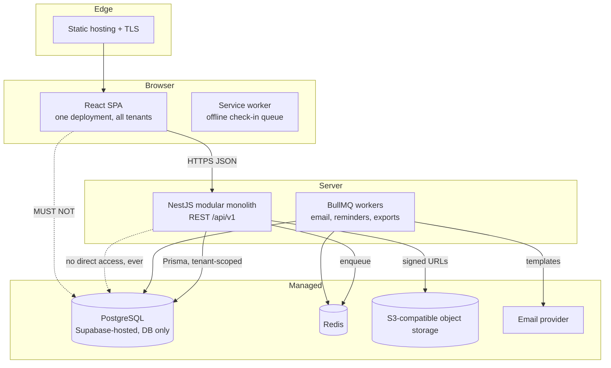

# 01 — System architecture

## Runtime shape



Only the API talks to the database. The browser never holds a database credential, a
Supabase key, or a Supabase client.

## Layers and responsibilities

| Layer | Owns | Must not do |
| --- | --- | --- |
| Client (React) | Rendering, client state, form UX, optimistic updates, offline scan queue | Enforce permissions, hold secrets, call the database |
| API (NestJS) | Authentication, authorisation, tenant resolution, business rules, validation, audit | Contain presentation logic, hard-code tenant branding |
| Data (PostgreSQL) | Integrity, constraints, tenant isolation via RLS, history retention | Contain business workflow logic beyond constraints |
| Workers (BullMQ) | Email, scheduled reminders, exports, follow-ups | Run without tenant context |

## Request lifecycle (tenant-scoped write)

```mermaid
sequenceDiagram
    participant B as Browser
    participant G1 as JwtAuthGuard
    participant G2 as TenantAccessGuard
    participant G3 as PermissionsGuard
    participant I as TenantContextInterceptor
    participant C as Controller
    participant S as Service
    participant T as TenantTransaction
    participant DB as PostgreSQL
    B->>G1: POST /api/v1/workspaces/village/events
    G1->>G1: verify access JWT, attach request.user
    G1->>G2: proceed
    G2->>DB: resolve workspace slug to org, verify membership
    G2->>G2: attach request.tenant (org id, permissions)
    G2->>G3: proceed
    G3->>G3: compare @RequirePermissions with tenant permissions
    G3->>I: proceed
    I->>I: AsyncLocalStorage.run({ organizationId, userId })
    I->>C: dispatch handler
    C->>S: call service with validated input
    S->>T: withTenant(tx)
    T->>DB: BEGIN; set_config('app.current_organization_id', ..., true)
    S->>DB: SELECT/INSERT with organization_id predicate
    DB-->>S: rows, filtered by RLS
    S-->>C: domain result
    C-->>B: { data, meta } envelope
    T->>DB: COMMIT (tenant settings discarded)
```

## Non-negotiable rules

1. **Supabase is a PostgreSQL endpoint.** No Auth, Storage, Edge Functions, Realtime,
   client libraries, or Supabase-as-API. Enforced by review and by the absence of any
   Supabase SDK dependency.
2. **Tenant identity is derived, never accepted.** `organizationId` from the client is
   ignored; it comes from the verified membership resolved by `TenantAccessGuard`.
3. **Two-layer isolation.** NestJS authorisation plus PostgreSQL RLS. Either layer alone
   is treated as insufficient.
4. **Transaction-local tenant context.** `SET LOCAL` semantics via `set_config(..., true)`
   so a pooled connection cannot leak one tenant's context into another request.
5. **Business logic lives in services.** Controllers translate HTTP; repositories translate
   Prisma. No rules in controllers, no HTTP types in services.
6. **Modules are declared, not improvised.** Every event module has a registry entry with
   id, priority, dependencies, permissions and configuration schema.
7. **Provider seams are adapters.** Storage (`StoragePort`), email (`EmailPort`) and
   future providers sit behind interfaces so PostgreSQL and object storage stay portable.
8. **History is retained.** Disabling a module or closing an event never destroys rows
   needed for year-over-year reporting.

## Monorepo layout

```
apps/api                     NestJS modular monolith
  prisma/
    schema.prisma            Phase 1 data model
    policies/                hand-written RLS SQL applied after migrations
  src/
    main.ts                  bootstrap: prefix, pipes, filters, Swagger, shutdown
    app.module.ts            composition root
    config/                  env schema and ConfigModule wrapper
    database/                PrismaService, tenant context, tenant transactions
    common/                  guards, decorators, interceptors, filters, pipes, types
    modules/                 one folder per domain module (see 08-backend-architecture)
    integrations/            storage, email and other provider adapters

apps/web                     React + TypeScript + Vite
  src/
    app/                     providers, router, route guards
    components/              ui primitives, layout shells, branding, form controls
    features/                one folder per product area
    services/                typed API client and per-area endpoint modules
    stores/                  small client state (Zustand)
    lib/                     env, i18n, class names, formatting
    styles/                  Tailwind entry, theme variables

packages/shared              Contracts consumed by both sides
  src/contracts/             Zod request/response schemas and inferred types
  src/platform/              permissions, roles, module registry, API paths
```

## Environment topology

| Environment | Database | Notes |
| --- | --- | --- |
| Local | Docker or Supabase project | Migrations via `prisma migrate dev`; RLS SQL applied by migration |
| Staging | Separate Supabase project | Same migration path, seeded demo tenants, load-test target |
| Production | Supabase PostgreSQL | Non-owner application role, backups and restore drills, Sentry |

Secrets live in the platform's secret store (or `.env` locally, never committed). The
web app receives only `VITE_API_URL` and public configuration.

## Scaling posture

- Stateless API instances behind a load balancer; sessions live in PostgreSQL, not memory.
- Connection pooling via the database provider's pooler, with transaction-scoped tenant
  context (compatible with PgBouncer transaction mode).
- Read-heavy public pages cached at the edge with tenant awareness in the cache key.
- BullMQ workers scaled independently of the API.
- A single large customer can later move to a dedicated database without changing the
  logical model — tenant id is already carried on every owned record.
