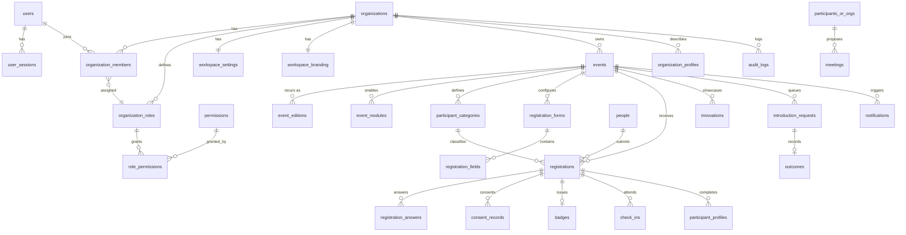
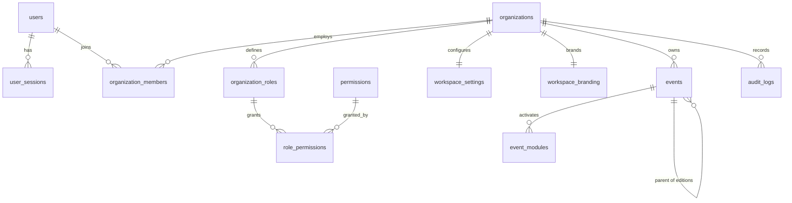

# 02 — Data model and ERD

## Modelling rules

1. **UUID primary keys** (`uuid`, generated in the database or by Prisma).
2. **Every tenant-owned row carries `organization_id`** directly, or reaches it through a
   constrained parent. Ambiguous ownership is a bug.
3. **Event-scoped rows additionally carry `event_id`.**
4. **Three distinct identity concepts**: `users` (login), `people` (the human in a
   registration), `registrations` (participation in one event). Never collapse them.
5. **Timestamps** `created_at` / `updated_at` everywhere; soft deletion only where the
   retention policy needs it.
6. **JSONB only for genuinely variable configuration** (module settings, form answers).
   Anything searchable or relational is normalised into columns and tables.
7. **Unique constraints** protect slugs, per-event registration identifiers and QR token
   identifiers.
8. **Indexes** on `organization_id`, `event_id`, `status`, `created_at` and frequent
   filters.
9. **Migrations only.** No manual production schema edits.
10. **Audit-sensitive actions** append to `audit_logs`.

## Conceptual ERD (full product)

`participants_or_orgs` is shorthand for "either participant profile or organisation
profile" — the concrete relation is defined when the meetings module is implemented
(Phase 5).

## Phase 1 schema (implemented in Prisma)

Phase 1 covers identity, tenancy, access control, workspace, branding and the event
container. Registration, profiles, operations and reporting tables arrive with their
phases; the ERD above is the target so migrations never conflict.

## Phase 1 tables

| Table | Purpose | Notable constraints |
| --- | --- | --- |
| `users` | Login identity | `email` unique; `status` enum; `is_platform_admin` |
| `user_sessions` | Refresh sessions, hashed tokens | index on `user_id`; `revoked_at`; `replaced_by_session_id` |
| `organizations` | The tenant | `slug` unique; `status` |
| `organization_members` | User ↔ organisation, with a role | `(organization_id, user_id)` unique |
| `organization_roles` | Per-tenant roles (system or custom) | `(organization_id, key)` unique |
| `permissions` | Global permission catalogue (`resource:action`) | `key` unique |
| `role_permissions` | Role → permission | composite PK `(role_id, permission_id)` |
| `workspace_settings` | Locale, time zone, preferences | `organization_id` unique |
| `workspace_branding` | Logo, colour tokens, appearance | `organization_id` unique |
| `events` | Event container, lifecycle, visibility | `(organization_id, slug)` unique; `parent_event_id` self-relation |
| `event_modules` | Enabled modules per event | `(event_id, module_key)` unique; `settings` JSONB |
| `audit_logs` | Append-only sensitive action log | index on `(organization_id, created_at)` |

### Why title-case Prisma models but snake_case tables

Prisma models read naturally in TypeScript (`OrganizationMember`), while tables follow
PostgreSQL convention (`organization_members`) because raw SQL — RLS policies, reports,
analytics — reads and writes them directly. Every model declares `@@map` and `@map`.

### Event editions

`events.parent_event_id` links an edition to its recurring programme. Each edition keeps
its own registrations, modules and reports, so comparison is a query, not a migration.
The alternative (one event row with an edition column) was rejected: it makes historical
reporting ambiguous and violates "records belong to an edition".

## Retention and deletion

- Completed events and their registrations are retained; deletion is an explicit,
  audited operation gated by retention policy.
- Disabling an event module flips `event_modules.enabled`; rows in that module's tables
  are untouched.
- Consent records and audit logs are append-only.
- Soft deletion (`deleted_at`) is reserved for records that must disappear from product
  views while staying legally retained. It is not a general-purpose pattern.

## Where the schema lives

- `apps/api/prisma/schema.prisma` — Phase 1 models, generated client, migrations.
- `apps/api/prisma/policies/tenant-rls.sql` — RLS policies (see `03-tenant-isolation-and-rls.md`).
- `apps/api/src/modules/permissions/permissions.seed.ts` — permission catalogue and
  default system roles.
