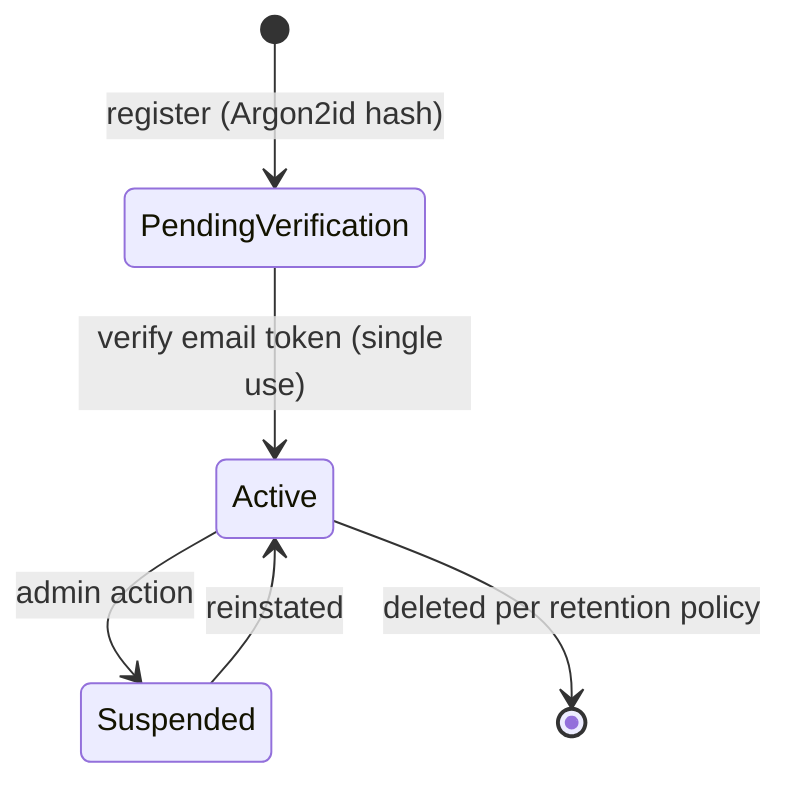
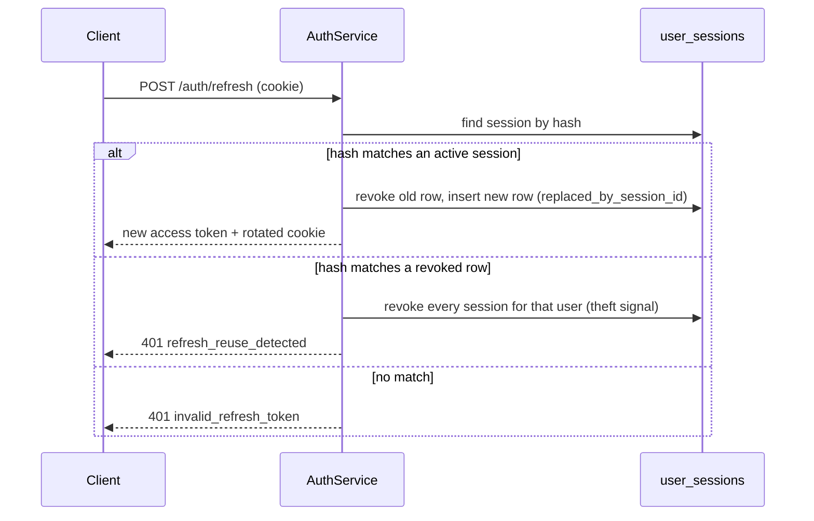

# 04 — Authentication and sessions

Custom authentication inside NestJS. Supabase Auth is not used, at all.

## Account lifecycle

1. Registration validates input and uniqueness, hashes with **Argon2id**, creates the
   account in `PENDING_VERIFICATION`, and issues a single-use, expiring verification token
   (stored hashed).
2. Verification activates the account.
3. Login validates credentials **and** status, then issues a short-lived access JWT plus a
   rotating refresh token.
4. Refresh revokes/rotates the prior token and detects reuse.
5. Logout and security events revoke the relevant sessions.

**Public event registration does not require an account.** A person and a registration can
exist independently of any login. Accounts are for ongoing participant features.

## Tokens

| Token | Form | Lifetime | Storage |
| --- | --- | --- | --- |
| Access JWT | Signed HS256 (RS256 when key rotation is introduced), minimal claims: `sub`, `sid`, `email`, `typ=access` | 15 minutes | Response body, held **in memory** by the SPA |
| Refresh token | Random 256-bit value, opaque | 30 days, rotated on use | `HttpOnly; Secure; SameSite=Lax` cookie scoped to the refresh path; **hash** stored in `user_sessions` |
| Email verification | Random, single use | 24 hours | Hash in database |
| Password reset | Random, single use | 30 minutes | Hash in database |

The access token is never persisted to `localStorage` — XSS should not yield a durable
session. Refresh lives in an HttpOnly cookie the JavaScript cannot read.

Password hashes are Argon2id with per-password salt; parameters are recorded so they can be
raised over time.

## Cookie and CSRF design

- Refresh cookie path is `/api/v1/auth` so it is not sent with ordinary API calls.
- `SameSite=Lax` blocks cross-site POSTs from third-party pages; the refresh endpoint
  additionally requires a double-submit CSRF token (`X-CSRF-Token` header matched against a
  non-HttpOnly cookie) for defense in depth where `SameSite` is not available.
- The refresh response returns a new access token only; the new refresh token replaces the
  cookie.
- CORS allows only configured origins with credentials enabled.

## Rotation and reuse detection

Reuse of an already-rotated refresh token is treated as compromise: all sessions for the
account are revoked and an audit entry is written.

## Revocation and session management

`user_sessions` supports listing (device, user agent, IP, last used), individual revocation
and global revocation. Suspension flips `users.status`; the short access-token lifetime
bounds staleness, and refresh fails immediately. Privileged roles are eligible for MFA;
the schema keeps the door open by treating MFA state as account-level data added in
Phase 7.

## Access control

- **Authentication** answers "who". **Authorisation** answers "may they, here".
- Authorisation is capability-based. The registry is
  `packages/shared/src/platform/capability-definitions.ts`; a member can act only when
  the organisation is entitled to the capability and the member holds it through a role
  or a direct grant. See `docs/16-capability-authorization.md`.
- Roles are reusable collections of capabilities. The `permissions` table remains the
  storage format of a role template and is mapped to capabilities at the boundary.
- Guards run in a fixed order: JWT → tenant resolution → capability check.
- Hiding a control in the UI is a convenience, never a control. The API is authoritative.

Default permission groups seeded per tenant:

| Role | Representative permissions |
| --- | --- |
| Organisation Admin | `workspace:manage`, `member:manage`, `event:manage`, `registration:manage`, `report:read` |
| Event Manager | `event:manage` for assigned events, `registration:read`, `report:read` |
| Registration Manager | `registration:manage`, `participant:read` |
| Check-in Staff | `checkin:operate` |
| Programme Manager | `programme:manage` (P1) |
| Reporting Officer | `report:read`, `report:export` |

The strings above are the storage format of each role template. At request time they are
mapped to capabilities and intersected with the organisation entitlement; the capability
keys are what the guards and the UI use. See `docs/16-capability-authorization.md`.

Event-scoped assignment ("assigned events") is modelled as a membership-to-event
assignment when Phase 3 lands; until then the Event Manager role is organisation-wide and
the limitation is stated in the UI.

## Session-related endpoints

| Method | Path | Notes |
| --- | --- | --- |
| POST | `/api/v1/auth/register` | Creates account, sends verification |
| POST | `/api/v1/auth/verify-email` | Single-use token |
| POST | `/api/v1/auth/login` | Access token in body, refresh cookie set |
| POST | `/api/v1/auth/refresh` | Rotates refresh, returns access token |
| POST | `/api/v1/auth/logout` | Revokes current session |
| GET | `/api/v1/auth/me` | Current user + memberships |
| POST | `/api/v1/auth/forgot-password` | Always 202, never reveals existence |
| POST | `/api/v1/auth/reset-password` | Single-use token |
| GET | `/api/v1/auth/sessions` | List active sessions |
| DELETE | `/api/v1/auth/sessions/:id` | Revoke one session |

## Rate limiting

Login, register, verify, forgot-password and refresh are rate limited per IP and per
account identifier. Exceeding the limit returns `429` with `Retry-After`. Attempts are
logged; repeated failures on one account raise an audit event.

## What we deliberately do not do

- No passwords or refresh tokens in `localStorage` or in URLs.
- No long-lived access tokens "for convenience".
- No Supabase Auth, no third-party identity provider in the MVP.
- No permission checks that exist only in the frontend.
