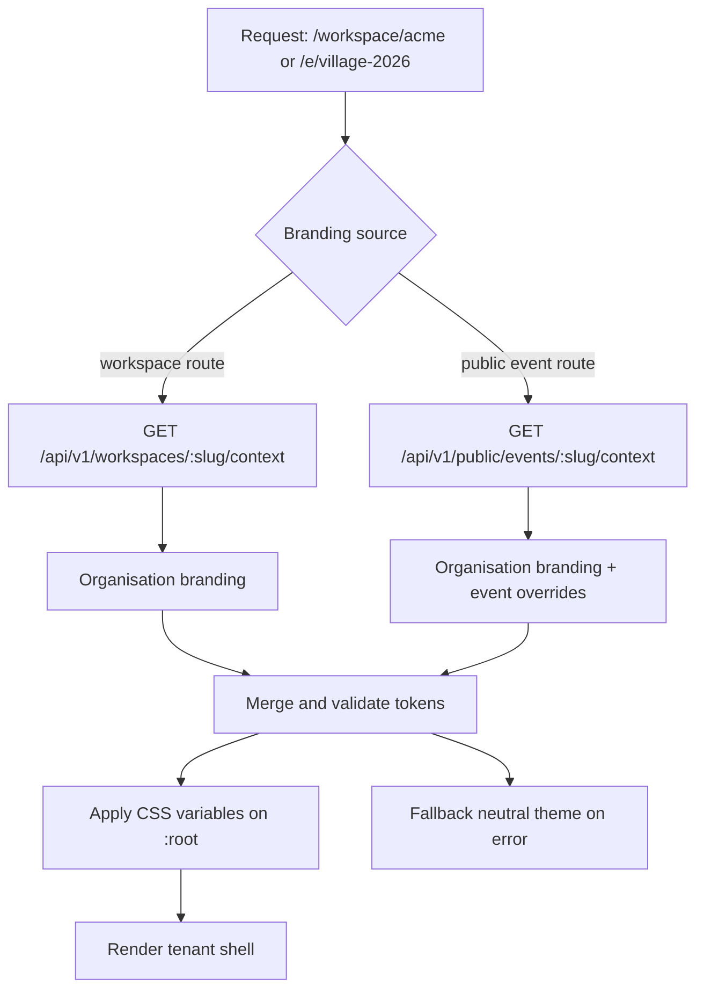

# 05 — Branding and theming

White-label means branding is **data**, resolved at runtime, applied through CSS custom
properties. Never a build per customer, never hard-coded per-tenant styles.

## Resolution order



- The SPA loads workspace context **before** rendering the tenant-specific shell. While
  loading it shows a neutral shell (no flash of the wrong brand).
- Event routes inherit organisation branding and may override selected tokens.
- The Super Admin console (`/platform/*`) uses Future Studio branding and ignores tenant
  themes.

## The token set

| Token | CSS variable | Notes |
| --- | --- | --- |
| Primary | `--brand-primary` | Buttons, active nav, links |
| Secondary | `--brand-secondary` | Secondary actions, accents |
| Accent | `--brand-accent` | Highlights, badges, data-wall figures |
| Background | `--brand-background` | Page canvas |
| Surface | `--brand-surface` | Cards, tables, panels |
| Text | `--brand-text` | Body copy on background/surface |
| Logo | `--brand-logo-url` / `--brand-logo-dark-url` | Light/dark variants |
| Favicon | `--brand-favicon-url` | Applied per workspace |
| Radius | `--brand-radius` | Optional; default 0.5rem |

Default palette (from the source plans):

```css
:root {
  --brand-primary: #173F5F;
  --brand-secondary: #206A8A;
  --brand-accent: #F5A623;
  --brand-background: #FFFFFF;
  --brand-surface: #F5F7FA;
  --brand-text: #172B4D;
  --brand-radius: 0.5rem;
}
```

## Validation rules

- Colours must parse as hex or `oklch`/`rgb` strings; anything else is rejected at the API
  boundary. (The Phase 1 contract accepts hex; broader colour syntaxes are a later change
  to the shared schema.)
- Contrast between `text` and `background`/`surface`, and between white and `primary`,
  must meet WCAG AA (4.5:1 for body text). The branding editor shows a warning with the
  measured ratio, and the API returns `contrastWarnings` alongside the saved branding
  rather than silently accepting an unreadable theme.
- Logos and banners: PNG, JPEG or WebP; SVG is refused because it can carry script and
  would be served from the same origin. Maximum 2 MB. The declared content type is never
  trusted alone — the bytes decide. Uploaded binaries go to object storage through the API;
  the database stores only references and metadata.

## Data and API

`workspace_branding` holds the organisation's tokens and asset references. The `events`
table holds the optional per-event overrides: `banner_url` plus the three colour
overrides. A null override means "inherit the workspace", so an existing event needs no
backfill.

The merge happens server-side in the public read model: the public event context returns
the workspace branding with the event's colours applied on top, so every public page
(event page, registration form, showcase) renders the same resolved theme without
duplicating the rule. The staff event-detail response keeps the overrides and the banner
separate, so the editing screen can tell "set" from "inherits" and clear them.

```ts
// GET /api/v1/workspaces/:slug/context
{
  "data": {
    "organization": { "id": "...", "slug": "acme", "name": "Acme Institute" },
    "branding": {
      "primaryColor": "#173F5F",
      "secondaryColor": "#206A8A",
      "accentColor": "#F5A623",
      "backgroundColor": "#FFFFFF",
      "surfaceColor": "#F5F7FA",
      "textColor": "#172B4D",
      "colorMode": "light",
      "logoUrl": "https://cdn.example/acme/logo.svg",
      "logoDarkUrl": null,
      "faviconUrl": "https://cdn.example/acme/favicon.png",
      "borderRadius": "0.5rem"
    },
    "locale": { "default": "fr", "supported": ["fr", "en"] }
  },
  "meta": { "requestId": "..." }
}
```

Public endpoints return only fields approved for public display. They never expose
members, contacts or internal identifiers beyond the slug.

## Frontend implementation

`components/branding/ThemeProvider`:

1. receives a resolved context (or `null` for platform admin),
2. writes the token values onto `document.documentElement.style`,
3. sets `<title>`, favicon link and logo references,
4. exposes `useBranding()` for components that need the organisation name or logo,
5. falls back to the default palette if a token is missing or invalid.

Applying on `:root` — rather than wrapping everything in a scoped element — means portals,
dialogs and toasts inherit the theme too.

## Caching

- Workspace context responses are cacheable at the edge with the **slug in the cache key**
  and a short TTL (60s) plus `ETag`.
- Branding changes bump `workspace_branding.updated_at`, which the API exposes as the
  `ETag` source, so a saved change propagates within one TTL.
- Super Admin and authenticated workspace responses are `private, no-store` unless the
  payload contains no tenant-private data.

## Which surfaces are branded

Workspace shell (sidebar, header, buttons, forms), public event pages, registration flow and
confirmation, participant views, badge design, and supported email templates. Badges and
emails receive the tokens server-side from the same branding record — the source of truth
does not fork between channels.
