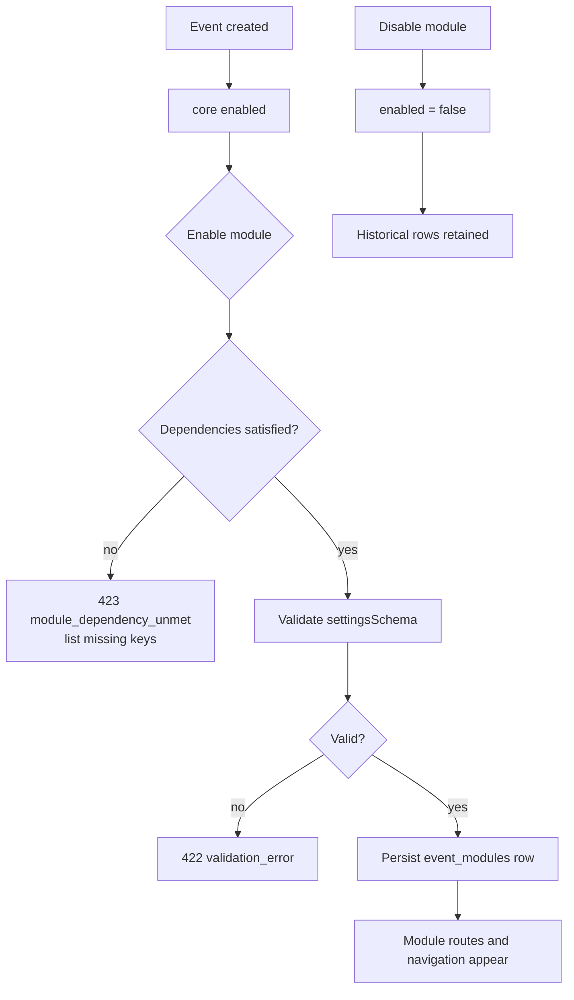

# 06 — Module registry

Modules are **declared configuration**, not branches in `if` statements scattered through
the codebase. A controlled registry — not a public marketplace — keeps the MVP honest.

## Registry entry

Defined once in `packages/shared/src/platform/module-registry.ts` and consumed by both
sides: the API validates activation and settings; the web app renders the catalogue,
dependency hints and configuration forms.

```ts
interface ModuleDefinition {
  key: string;                    // stable identifier stored in event_modules.module_key
  name: string;                   // display name, localised key in the UI
  summary: string;
  priority: 'core' | 'p0' | 'p1' | 'p2';
  dependsOn: string[];            // module keys that must also be enabled
  requiredPermissions: string[];  // permissions needed to configure it
  settingsSchema: ZodTypeAny;     // validated server-side on save, reused client-side
  defaults: Record<string, unknown>;
  configurable: boolean;          // false for modules auto-enabled with the event
}
```

## Catalogue

| Key | Name | Priority | Depends on | Notes |
| --- | --- | --- | --- | --- |
| `core` | Event core | core | — | Always on; cannot be disabled |
| `publishing` | Publishing & discovery | p0 | `core` | Public page, visibility, listing |
| `registration` | Registration & badges | p0 | `core` | Categories, forms, consent, QR badges |
| `showcase` | Profiles & showcase | p0 | `registration` | Requires registrations to attach listings to |
| `meetings` | Meetings & networking | p0 | `showcase` | Needs declared interests and availability |
| `introductions` | Introduction queue | p0 | `showcase` | Can run without meetings |
| `checkin` | Check-in | p0 | `registration` | Needs issued badges |
| `reporting` | Dashboards & reports | p0 | `core` | Always valuable; read-only |
| `agenda` | Agenda & sessions | p1 | `core` | Phase after MVP |
| `surveys` | Surveys & follow-up | p1 | `registration` | Post-event feedback |
| `sponsors` | Sponsor portal | p2 | `core` | Later release |
| `ai` | AI assistance | p2 | `showcase` | Tagging, summaries, meeting briefs |

## How activation works

1. The setup wizard reads the catalogue and shows each module with its summary,
   dependencies and required permissions.
2. Enabling a module with unmet dependencies is rejected with `module_dependency_unmet` and
   the missing keys.
3. Recommendations are offered as suggestions, never forced.
4. Settings are validated against `settingsSchema` before persisting to
   `event_modules.settings`.
5. Publishing validates that every enabled module has its required settings.



## Rules

- **Disabling never deletes history.** `event_modules.enabled = false` hides UI and blocks
  new writes through the module's endpoints; existing rows remain queryable for reporting.
- **Module availability is platform-controlled.** Super Admin decides which modules a
  tenant may enable (Phase 3 adds `organization_modules`); the registry defines what
  exists.
- **No marketplace.** Third-party plugins are out of scope; extensions arrive as
  first-party registry entries behind adapter seams.
- **One module, one folder.** The API enforces this with a module folder per domain; the
  registry key maps to the event-level capability, and the NestJS module implements it.
- **Permissions gate configuration, not just visibility.** Required permissions are
  checked by the API before settings are written.

## Localisation

`name` and `summary` are keys resolved through the web app's translation resources
(`modules.<key>.name`, `modules.<key>.summary`) in English and French, so the catalogue is
never hard-coded in one language.

## Where it lives

- `packages/shared/src/platform/module-registry.ts` — definitions and settings schemas
- `apps/api/src/modules/module-registry/` — catalogue endpoint, dependency validation,
  event module activation (Phase 3)
- `apps/web/src/features/modules/` — catalogue UI, dependency warnings, settings forms
