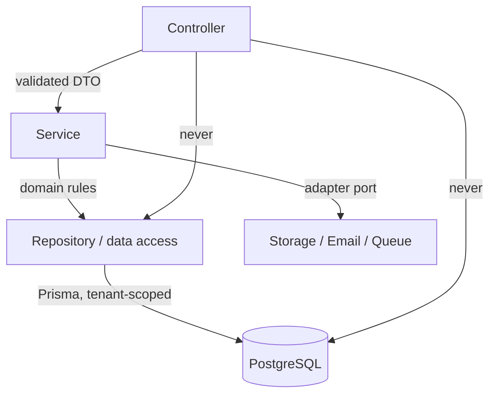

# 08 — Backend architecture

NestJS modular monolith. One deployable, many well-bounded modules.

## Layering rule



- **Controllers** translate HTTP: read route/query/body, call one service method, return.
  No branching on business state, no Prisma.
- **Services** own business rules, transactions and audit events. Framework-agnostic where
  practical; they receive plain inputs and return plain domain objects.
- **Repositories** own Prisma queries. They accept a tenant-scoped transaction client and
  always include explicit tenant predicates.
- **Adapters** implement provider ports (`StoragePort`, `EmailPort`) so S3 and the email
  vendor stay replaceable.

## Module map

```
src/modules/
  health/               liveness/readiness (public)
  auth/                 register, verify, login, refresh, logout, sessions
  users/                account profile and status (Phase 1)
  organizations/        tenant creation and lifecycle
  memberships/          invitations, memberships, role assignment
  permissions/          permission catalogue, RBAC evaluation, seeding
  workspaces/           slug, locale, preferences, public context endpoint
  branding/             brand tokens, assets, resolution for events and emails
  events/               event CRUD, lifecycle, visibility, editions
  module-registry/      catalogue, dependency validation, event module activation
  registration-forms/   categories, form definitions, field validation
  registrations/        submissions, consent, approvals, duplicate detection
  participants/         person records
  profiles/             participant and organisation profiles
  innovations/          showcase listings, approval, search
  meetings/             availability, proposals, accept/decline, outcomes
  introductions/        request queue, assignment, decisions, outcomes
  badges/               QR token issuance and verification
  check-in/             scans, deduplication, offline sync, attendance
  notifications/        templates, delivery status, email adapter
  reports/              aggregates, CSV/PDF exports
  analytics/            live operational metrics
  consent/              consent purposes, versions, records
  audit-logs/           append-only sensitive action log
```

Folder convention:

```
modules/events/
  events.module.ts          NestJS wiring, imports/exports only
  events.controller.ts      HTTP surface
  events.service.ts         business rules
  events.repository.ts      Prisma access, tenant-scoped
  dto/events.contract.ts    re-exports shared Zod schemas + Swagger decorators
  events.service.spec.ts    unit tests
```

## Dependency rules between modules

1. A module may import another module's **service**, never its repository or controller.
2. No circular imports. If two modules need each other, extract the shared concern into a
   lower-level module (e.g. `permissions`, `audit-logs`).
3. Cross-cutting concerns live in `common/` as guards, decorators, interceptors, filters
   and pipes — not in feature folders.
4. `database/` is global; feature modules depend on it but never construct clients.
5. Public read models used by public endpoints live in the owning module with explicit
   projection methods.

## Cross-cutting pipeline

| Concern | Implementation | Scope |
| --- | --- | --- |
| Authentication | `JwtAuthGuard` | Global, opt out with `@Public()` |
| Tenant resolution | `TenantAccessGuard` | Global, active only with `@TenantScoped('slug')` |
| Authorisation | `PermissionsGuard` | Global, driven by `@RequirePermissions()` |
| Tenant context | `TenantContextInterceptor` | Wraps handler in AsyncLocalStorage |
| Validation | `ZodValidationPipe` | Per route with a shared schema |
| Response envelope | `ResponseEnvelopeInterceptor` | Global |
| Error normalisation | `AllExceptionsFilter` | Global |
| Request correlation | `requestId` middleware | Global |
| Security headers | `helmet` | Global |
| Rate limiting | Nest throttler buckets | Per route group |

## Tenant-scoped data access

```ts
// module service
return this.tenantTransaction.withTenant(async (tx) => {
  return this.events.findMany(tx, { organizationId: ctx.organizationId, status });
});
```

- `withTenant` opens `$transaction`, sets transaction-local `app.current_organization_id`
  (and `app.current_user_id`), runs the callback, commits.
- Nothing else in the codebase issues `SET`/`set_config`.
- Raw SQL is allowed only in `prisma/policies` or a documented, reviewed repository method.

## Configuration

`config/env.validation.ts` defines the environment contract with Zod. Boot fails fast with
a readable listing of missing/invalid variables. Type-safe access through
`ConfigService<Env, true>`; no `process.env` reads inside feature code.

## Observability

- Structured JSON logs with `requestId`, `organizationId` (never personal data), route,
  status, duration.
- Sentry for exceptions; the `requestId` is attached as a tag.
- Health endpoints: `/api/v1/health` (liveness), `/api/v1/health/ready` (database
  connectivity).
- Audit logs are product data, not logs: queryable, tenant-scoped, retained.

## Testing strategy

| Level | Tooling | Proves |
| --- | --- | --- |
| Unit | Jest | Services, state transitions, permission policies, token logic |
| Integration | Jest + real PostgreSQL | Prisma queries, migrations, RLS, tenant transactions, adapters |
| Contract | Jest against shared schemas | API payloads match `packages/shared` |
| API/E2E | Supertest | Onboarding, publishing, registration, approval, check-in |
| Security | Jest, dedicated suite | Tenant A/B isolation, escalation, refresh reuse, CSRF, rate limits |
| Reliability | Jest + queue harness | Offline sync, duplicates, retries, restore |
| Performance | k6 (Phase 7) | Registration bursts, check-in peaks, report generation |

The security suite is mandatory in CI from Phase 2 onward: a failing tenant-isolation test
blocks merge.

## Implementation sequence (mapped to the roadmap)

| Step | Deliverable |
| --- | --- |
| BE 1 Foundation | App boot, config, Prisma, health, envelope/filter, module skeleton |
| BE 2 Identity & tenancy | Users, sessions, auth, memberships, roles, permissions, tenant guards, RLS |
| BE 3 Workspace & branding | Onboarding, settings, branding, storage adapter |
| BE 4 Events & modules | Events, editions, lifecycle, module registry, event module settings |
| BE 5 Registration | Categories, forms, submissions, consent, people, registrations, badges |
| BE 6 Operations | Profiles, showcase, meetings, introductions, QR verification, check-in sync |
| BE 7 Reporting | Aggregates, dashboards, exports |
| BE 8 Production readiness | Security, load, observability, backups, deployment |

## What is intentionally absent

- No microservices, no message broker beyond BullMQ, no CQRS framework.
- No repository-per-table ceremony where Prisma's typed client is sufficient — a
  repository exists when it earns its keep (complex queries, tenant scoping, reuse).
- No event-level `if (moduleEnabled)` scattered in controllers; module gating is a guard
  plus a service check, driven by the registry.
