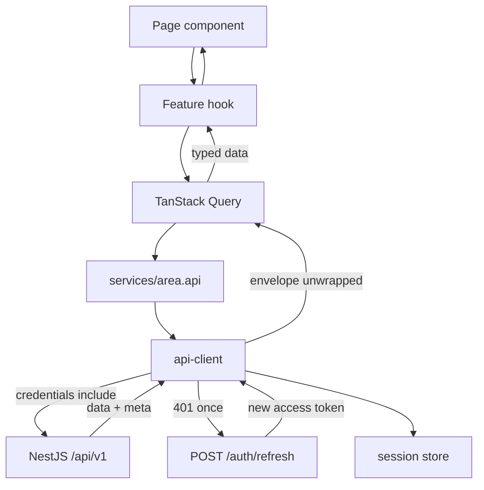
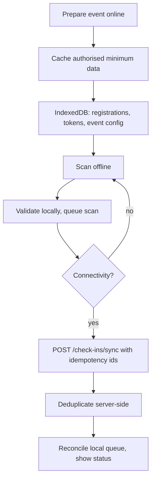

# 09 — Frontend architecture

One React application, one deployment, five experiences, mobile-first where it matters.

## Experiences and routes

| Route | Experience | Rendering notes |
| --- | --- | --- |
| `/login`, `/register`, `/forgot-password`, `/reset-password` | Auth | Neutral branding, no workspace context |
| `/platform/*` | Super Admin | Future Studio branding; cross-tenant views; audited |
| `/workspace/:slug` | Workspace dashboard | Branding resolved before shell renders |
| `/workspace/:slug/settings/profile` | Organisation profile | Admin only |
| `/workspace/:slug/settings/branding` | Branding editor + live preview | Admin only |
| `/workspace/:slug/team` | Members, invitations, roles | Admin only |
| `/workspace/:slug/events` | Event portfolio | Filters, status, search |
| `/workspace/:slug/events/new` | Setup wizard | Save and resume |
| `/workspace/:slug/events/:eventId/*` | Event overview, modules, registrations, showcase, operations, reports | Nested routes, permission-aware |
| `/e/:eventSlug` | Public event page | Public projection, branded |
| `/e/:eventSlug/register` | Registration flow | Mobile-first, dynamic form |
| `/e/:eventSlug/showcase` | Public listings | Approved content only |
| `/participant/*` | Participant area | Account required; badge, profile, meetings |
| `/staff/:eventId/check-in` | Staff check-in | Mobile-first, offline queue, large targets |

## Folder structure

```
src/
  app/
    providers/       AppProviders (query client, i18n, theme host)
    router.tsx       route tree, lazy feature pages
    guards/          RequireAuth, RequirePermission
    App.tsx
  components/
    ui/              primitives: button, input, dialog, table, badge
    layout/          AppShell, WorkspaceShell, PublicShell, StaffShell
    branding/        ThemeProvider, Logo, useBranding
    forms/           reusable field components bound to RHF + Zod
  features/
    auth/            LoginPage, RegisterPage, useSession
    platform-admin/  orgs, module availability, platform metrics
    workspace/       dashboard, onboarding
    branding/        editor, preview
    team/            members, invitations, roles
    events/          portfolio, wizard, detail, modules
    registrations/   list, detail, approval
    participants/    profiles
    innovations/     showcase admin + public listing
    meetings/        proposals, accept/decline
    introductions/   queue, assignment, decisions
    check-in/        scanner, queue status, sync
    reports/         charts, exports
  services/
    api-client.ts    fetch wrapper, auth header, refresh, envelope unwrap
    auth.api.ts
    workspaces.api.ts
    events.api.ts
  stores/
    session.store.ts Zustand: in-memory access token + user summary
    ui.store.ts      sidebar state, locale override
  lib/
    env.ts           validated VITE_* access
    i18n.ts          locale resolution + dictionary lookup
    cn.ts            class merge helper
    query-keys.ts    TanStack Query key factory
  styles/
    index.css        Tailwind entry + brand token defaults
  locales/
    en.ts, fr.ts     translation dictionaries
```

Rules:

1. **Feature folders are self-contained.** A feature owns its pages, components, hooks and
   API calls. Cross-feature reuse moves to `components/` or `lib/`.
2. **Pages are thin.** They compose feature components and handle route parameters.
3. **Server state belongs to TanStack Query.** Zustand holds only what the server does not:
   in-memory token, UI preferences, draft wizard state that must survive navigation.
4. **No direct fetch calls in components.** Everything goes through `services/`.
5. **Types come from `@event-platform/shared`.** No hand-written duplicate response types.

## Data flow



- The access token lives in memory only; a page reload triggers one silent refresh using
  the HttpOnly cookie.
- 401 handling is single-flight: concurrent failures share one refresh request, then retry.
- A failed refresh clears the session and redirects to `/login?next=…`.

## Branding host

`ThemeProvider` lives in `components/branding` and wraps the router output. Workspace and
public-event route elements resolve their context first (`useWorkspaceContext`) and pass it
down. Until resolved, `WorkspaceShell` renders a neutral skeleton — never another tenant's
colours.

## Forms

- React Hook Form + `zodResolver` with schemas from the shared package.
- Registration forms are generated from the event's form schema: the renderer maps field
  definitions (`text`, `email`, `phone`, `select`, `radio`, `checkbox`, `file`) to
  components and validates with the same Zod shape the API enforces.
- Consent is presented with its version and context; the version is submitted and recorded.

## Offline check-in



- A service worker caches the app shell and the prepared event dataset.
- Scans are written to IndexedDB with a stable scan id before any network attempt, so a
  refresh or crash loses nothing.
- The UI always shows queue depth and last successful sync; "manual lookup" remains
  available as the documented fallback.
- Personal data cached on device is limited to what check-in requires, with an explicit
  device-loss procedure in the operations runbook.

## Accessibility and localisation

- Keyboard navigable, visible focus, labelled controls, dialog semantics, announced errors.
- Contrast warnings surface in the branding editor; runtime theme application never
  reduces text contrast below AA without a warning.
- French and English strings live in `locales/`; no literals in components beyond dev
  placeholders. Dates, numbers and times format per locale and the event's time zone.
- Large touch targets (≥44px) and thumb-reachable primary actions on staff and
  registration screens.

## Testing

| Level | Tool | Covers |
| --- | --- | --- |
| Unit | Vitest | Hooks, formatters, guards, queue logic |
| Component | Vitest + Testing Library | Forms, theme application, empty/error states |
| E2E | Playwright | Onboarding → publish → register → check-in, FR/EN, mobile viewport |

Loading, empty, error, permission-denied and offline are **states we build deliberately**,
not afterthoughts; each feature component demonstrates all five.

## Frontend milestones

| Stage | Deliverable | Definition of done |
| --- | --- | --- |
| FE 1 Foundation | Vite app, router, tokens, UI primitives, API client, auth shell | Builds, routes work, auth/error states handled |
| FE 2 Workspace | Shell, tenant resolution, onboarding, branding + preview | Two orgs, one deployment, distinct branding |
| FE 3 Events | Portfolio, wizard, detail, module config, public page | Draft → publish a branded event |
| FE 4 Registration | Dynamic forms, categories, confirmation, badge | Public registration with correct event state |
| FE 5 Operations | Profiles, showcase, meetings, queue, check-in | Works on desktop and mid-range mobile |
| FE 6 Reporting | Dashboards, charts, filters, exports | Metrics scoped, exports functional |
| FE 7 QA | A11y, i18n, responsive, offline, E2E | Critical journeys pass on supported browsers |
