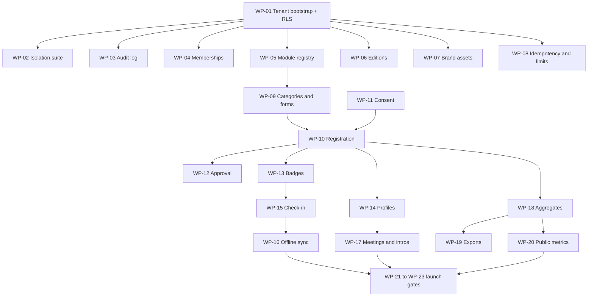

# 14 — Backend work packages

The backend plan, split into packages that a single person or agent can complete without
asking questions, and that can run **in parallel** because no two packages write the same
files.

Read `13-coding-rules.md` first: every package is bound by it.

## How a package runs

Hand one brief to one worker. The brief names the goal, the files it owns, the contract it
must satisfy and the checks that prove it is done. The worker does not need context from any
other package.

A package is **done** when all of these are true:

```sh
npm run check:conventions
npm run typecheck
npm run test
npm run build
```

plus: every acceptance case in the brief has a test (R11), and the worker left a short
handover note (what changed, what is next, what is risky).

## The three-step wave model

Parallel work only works if the shared surface is frozen before it starts.

1. **Pre-flight (serial, one worker).** Apply everything the wave's packages need but must
   not edit themselves: schema models, shared contracts, permission keys, module
   registration, seed entries, one migration. Result: the schema and the contracts are
   frozen for the whole wave.
2. **Packages (parallel).** Each worker implements inside its own paths against the frozen
   schema and contracts. No shared file is touched.
3. **Integration (serial, one worker).** Wire-up verification, migration applied to a fresh
   database, the isolation suite, and the documentation update.

A package that discovers it needs a schema or contract change it did not declare **stops**
and raises it for the next pre-flight. It does not edit shared files.

## Shared files — frozen during a wave

| File | Why it conflicts | Who edits it |
| --- | --- | --- |
| `apps/api/prisma/schema.prisma` | one file, every package would touch it | pre-flight only |
| `apps/api/prisma/migrations/**` | ordering must be linear | pre-flight only |
| `apps/api/prisma/seed.ts` | permission and role catalogue | pre-flight only |
| `packages/shared/src/index.ts` | one barrel, every new contract edits it | pre-flight only |
| `packages/shared/src/platform/permissions.ts` | permission vocabulary | pre-flight only |
| `apps/api/src/app.module.ts` | module registration is one list | pre-flight only |
| `package.json` (all three) | dependency and script changes | pre-flight only |

If a package needs an entry in one of these, it writes an **integration request** in its
handover note: exact file, exact lines, exact reason. The pre-flight applies it.

## Dependency graph



## Packages

Briefs exist for every package in waves 0 and 1. Later briefs are written when their wave
opens, so they describe the code that exists by then instead of guessing.

**Delivered:** WP-01 (tenant bootstrap and RLS) and WP-02 (isolation suite).

| Package | Wave | Owns | Depends on | Parallel-safe |
| --- | --- | --- | --- | --- |
| WP-01 Tenant bootstrap + RLS | 0 | `database/`, `common/guards/`, `prisma/policies/` | — | **no** (blocking) |
| WP-02 Isolation suite | 0 | `apps/api/test/` | WP-01 | with WP-01 authoring |
| WP-03 Audit log | 1 | `common/audit/`, `modules/audit/` | WP-01 | yes |
| WP-04 Memberships + invitations | 1 | `modules/memberships/` | WP-01 | yes |
| WP-05 Module registry | 1 | `modules/module-registry/` | WP-01 | yes |
| WP-06 Editions + recurrence | 1 | `modules/events/` | WP-01 | yes |
| WP-07 Brand assets | 1 | `integrations/storage/`, `modules/workspaces/` | WP-01 | yes |
| WP-08 Idempotency + rate limits | 1 | `common/idempotency/`, `common/guards/` | WP-01 | yes |
| WP-09 Categories + forms | 2 | `modules/registration-forms/` | WP-05 | yes |
| WP-10 Registration submission | 2 | `modules/registrations/` | WP-09, WP-11 | yes |
| WP-11 Consent records | 2 | `modules/consent/` | — | yes |
| WP-12 Approval workflow | 2 | `modules/registrations/` (approval slice) | WP-10 | no |
| WP-13 Badges | 2 | `modules/badges/` | WP-10 | yes |
| WP-14 Profiles + showcase | 2 | `modules/profiles/`, `modules/participants/` | WP-10 | yes |
| WP-15 Check-in | 3 | `modules/check-in/` | WP-13 | yes |
| WP-16 Offline sync | 3 | `modules/check-in/` (sync slice) | WP-15 | no |
| WP-17 Meetings + introductions | 3 | `modules/meetings/`, `modules/introductions/` | WP-14 | yes |
| WP-18 Aggregates | 4 | `modules/reports/` | WP-10 | yes |
| WP-19 Exports | 4 | `modules/reports/` (export slice) | WP-18 | no |
| WP-20 Public metrics | 4 | `modules/analytics/` | WP-18 | yes |
| WP-21 E2E journeys | 5 | `apps/api/test/` | all | no |
| WP-22 Performance + limits | 5 | `scripts/`, `common/guards/` | WP-21 | yes |
| WP-23 Backup + deployment review | 5 | `docs/`, `scripts/` | all | yes |

### Wave 3 briefs

Wave 3 is now written but **cannot run**: every package depends on a wave 2 package that does
not exist in the tree yet.

| Package | Brief | Blocked by |
| --- | --- | --- |
| WP-15 Check-in | [WP-15-check-in.md](work-packages/WP-15-check-in.md) | WP-05, WP-13 (badges) |
| WP-16 Offline sync | [WP-16-offline-sync.md](work-packages/WP-16-offline-sync.md) | WP-15, WP-08 |
| WP-17 Meetings + introductions | [WP-17-meetings-and-introductions.md](work-packages/WP-17-meetings-and-introductions.md) | WP-05, WP-14 (profiles) |

Current tree state: WP-01 is applied; waves 1 and 2 are not implemented, the schema still
stops at Phase 1, and no wave 2 briefs exist. Running a wave 3 package now would force it to
invent the `badges`, `registrations`, `participant_profiles` and `check_ins` tables that WP-13,
WP-10 and WP-14 own — the exact conflict the wave model forbids. The order to restore is:
wave 1 briefs and code, then wave 2, then wave 3. Each wave 3 brief repeats this prerequisite
table at its top.

## Conflict checklist before starting a package

- [ ] Every file you will edit is inside your owned paths.
- [ ] The model you need already exists in the schema (frozen in pre-flight).
- [ ] The contract you return already exists in the shared package.
- [ ] The permission string you check is in the catalogue.
- [ ] Your module is registered (pre-flight) or you have an integration request for it.
- [ ] You know which acceptance cases become tests.

## Ordering rule that is not negotiable

WP-01 comes before any package that reads tenant-owned data. Enabling row-level security
while membership resolution still runs without tenant context makes every tenant route
return nothing. The order is the whole point of the wave model.
